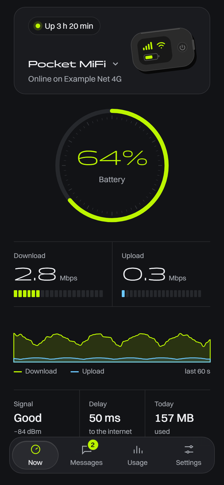
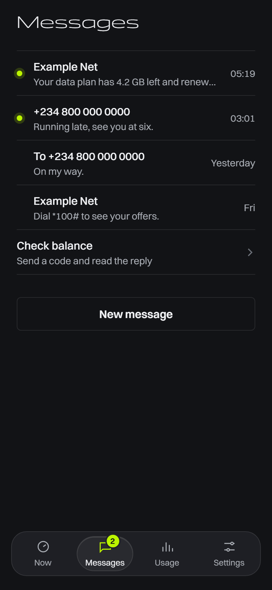
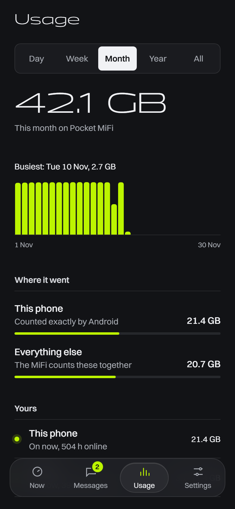
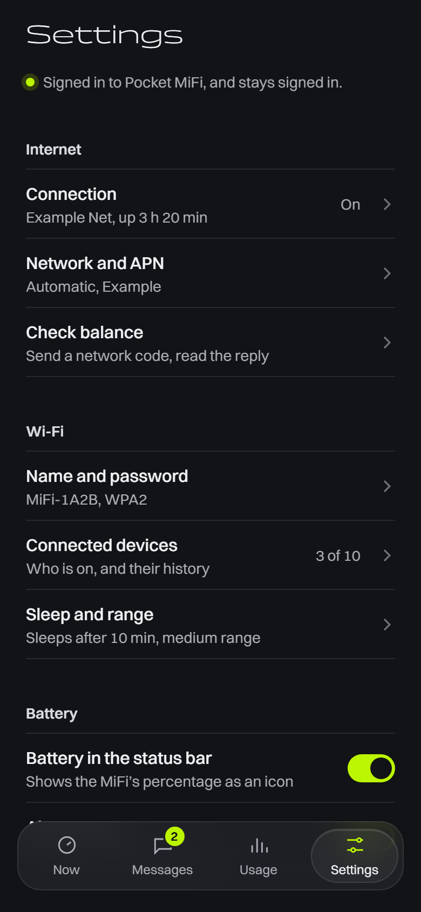
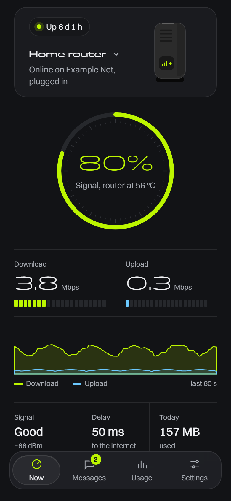

<h1 align="center">MiFi</h1>

<p align="center">
  An Android app for pocket MiFis and 4G home routers.<br>
  Battery in your status bar, live speed, texts, data used per device, and every setting, without opening the box's web page.
</p>

<p align="center">
  <a href="https://github.com/hebronmimam/mifi-app/releases/latest"></a>
  <a href="https://github.com/hebronmimam/mifi-app/releases"></a>
  
  <a href="LICENSE"></a>
</p>

<p align="center">
  <a href="https://github.com/hebronmimam/mifi-app/releases/latest"><b>Download the APK</b></a>
  &nbsp;·&nbsp;
  <a href="#install">Install</a>
  &nbsp;·&nbsp;
  <a href="#supported-devices">Supported devices</a>
  &nbsp;·&nbsp;
  <a href="#feedback-and-feature-requests">Feedback</a>
</p>

<p align="center">
  
  
  
  
  
</p>

<p align="center"><sub>Screenshots use made-up demo data.</sub></p>

## Features

| | |
|---|---|
| **Battery in the status bar** | The MiFi's battery percentage is the notification icon, so you see it without opening anything. One alert at 20%. |
| **Live speed** | Download and upload right now, with the last minute as a chart. |
| **Texts** | New texts on the box arrive as normal Android notifications. Read, reply, write, delete, and send balance codes (USSD) and read the reply. |
| **Data used** | Day, week, month, year or all time. Who used what, kept until you clear it. Export it as CSV. |
| **Settings** | Wi-Fi sleep, network mode, connect and disconnect, UPnP, restart, shut down and factory reset. |
| **Stays signed in** | Type the admin password once. It stays on your phone, encrypted by Android. |
| **Updates itself** | New screens install by themselves. A new app version asks you for one tap to install. |
| **Nothing changed on the box** | It uses the box's own web API. No firmware changes and nothing installed on the MiFi or router. |

## Install

1. Download `mifi-<version>.apk` from the [latest release](https://github.com/hebronmimam/mifi-app/releases/latest) on your phone.
2. Open it. If Android asks, allow your browser or file manager to install unknown apps.
3. Join your MiFi's or router's Wi-Fi and open the app. It finds the box on its own.
4. Type the box's admin password once. That's the password for the box's web page (often on a sticker under the battery), not the Wi-Fi password.
5. Allow notifications so the battery shows in the status bar and new texts reach you.

The app is not on the Play Store. Every release is built from this repository and signed with the same key, so updates install over the top.

## Supported devices

| Device | Status |
|---|---|
| ZTE-based pocket MiFis (goform web API), such as the MTN U10LS | Tested |
| Tozed ZLT home routers, such as MTN-branded X100 Pro family units | Tested |
| Other ZTE MiFis with the same web page | Likely to work. [Tell me](#feedback-and-feature-requests) how it goes. |

If your box isn't listed, the app says so instead of guessing. Feature requests for other boxes are welcome.

## How it works

**Speed is live traffic, not a speed test.** About once a second the app asks the box how many bytes it moved, for every device connected to it. Boxes add to that count in bursts, so the app shows the average of the last 3 seconds. When nothing is downloading, it reads close to 0.

**Data used per device.** Neither box counts data per device. They only count the whole SIM. So this phone's data is exact (Android counts it), and every other device shows the least and the most it could have used, worked out from who was online each hour.

**Battery checks.** A small foreground service checks every 5 minutes, every minute while the battery is low or the internet is down, and every 15 minutes in battery saver.

**Talking to the box.** Web pages served over `https` can't reach a plain-`http` address on your Wi-Fi, so the screens are HTML and every call to the box goes through the Android app's native layer. The details are in [docs/PROTOCOL.md](docs/PROTOCOL.md).

## Privacy

- Everything stays on your phone. No accounts, analytics or ads, and no servers of mine.
- The admin password is encrypted with a key held in the Android Keystore. It is never logged or backed up.
- The only connections outside your Wi-Fi are GitHub, to check this repository for updates; Fontshare, for the fonts; and a bare connection to Cloudflare's or Google's DNS (`1.1.1.1`, `8.8.8.8`) to time the delay. No data is sent in that one.

## Permissions

| Permission | Why |
|---|---|
| Internet, network state | Talk to the box on your Wi-Fi, and check GitHub for updates |
| Notifications | Battery in the status bar, new texts, the 20% alert |
| Foreground service, wake lock, start at boot | Keep the battery icon current, also after a restart |
| Ignore battery optimisation (asked, optional) | Stop Android from pausing the battery checks |
| Install packages | Install a new version you downloaded from inside the app |

## FAQ

<details>
<summary><b>It says it can't find the box.</b></summary>

Join the MiFi's or router's Wi-Fi first. The app only talks to the box over its own Wi-Fi, never over mobile data.
</details>

<details>
<summary><b>Which password does it want?</b></summary>

The admin password for the box's web page, not the Wi-Fi password. On many MiFis it's on a sticker under the battery, and the default is often `admin`.
</details>

<details>
<summary><b>The box locked me out after a wrong password.</b></summary>

The box locks sign-in after a few wrong tries. The app shows how long until you can try again, and never retries a rejected password on its own.
</details>

<details>
<summary><b>Why does another device show a range instead of an exact number?</b></summary>

The box doesn't count data per device. See [How it works](#how-it-works).
</details>

<details>
<summary><b>Does it change anything on my MiFi?</b></summary>

Only the settings you change in the app, through the same web API the box's own page uses. Nothing else is installed or modified.
</details>

## Building

You need JDK 17 and the Android SDK (API 35).

```bash
./gradlew assembleDebug testDebugUnitTest
```

To work on the screens in a desktop browser, serve `app/src/main/assets/web` and open `index.html`. `dev.js` stands in for the phone with made-up data. Add `?s=router`, `signin`, `wifi`, `low` or `dropped` to see the other states. `dev.js` is left out of the APK.

### Project layout

```
app/src/main/java/…/mifi   Android shell: WebView, native bridge, device clients, battery service
app/src/main/assets/web    The screens: index.html, app.css, app.js
docs/PROTOCOL.md           How the app talks to each box
keys/web-bundle.pub        Public key that checks screen updates
tools/release.mjs          Builds, signs and publishes a release
```

### Updates

The app checks this repository's releases once a day. When it finds a newer `web-<n>.zip`, it checks the zip's signature against `keys/web-bundle.pub` and swaps the screens in without asking. If the signature doesn't match, the zip is never loaded. A new app version is an APK on a `v<version>` release. The app downloads it, and then Android asks you to tap Install.

### Releasing

Signing keys live outside the repository:

- Set `mifi.signing` in your user `gradle.properties` to a properties file with `storeFile`, `storePassword`, `keyAlias` and `keyPassword`.
- Point `MIFI_WEB_KEY` at the PKCS#8 private key whose public half is `keys/web-bundle.pub`.

```bash
node tools/release.mjs --publish            # app + screens, tagged v<versionName>
node tools/release.mjs --web-only --publish # screens only, tagged web-<n>
```

Bump `web` in `assets/web/version.json` for new screens. Bump `versionCode` and `versionName` in `app/build.gradle.kts` for a new app.

## Contributing

Bug reports, device reports and pull requests are welcome. Read [CONTRIBUTING.md](CONTRIBUTING.md) first. Report security problems privately, as [SECURITY.md](SECURITY.md) explains.

## Feedback and feature requests

Found a problem, or want the app to do something new? Message me on [WhatsApp](https://wa.me/2348149322169) or [Facebook](https://www.facebook.com/hebronmimam), or [open an issue](https://github.com/hebronmimam/mifi-app/issues/new/choose).

## Credits

Made by [Hebronmimam](https://hebronmimam.com). The screens use Panchang and Switzer from [Fontshare](https://www.fontshare.com), loaded at run time and not included here. Offline, the phone's system font stands in.

## Licence

MIT. See [LICENSE](LICENSE).
